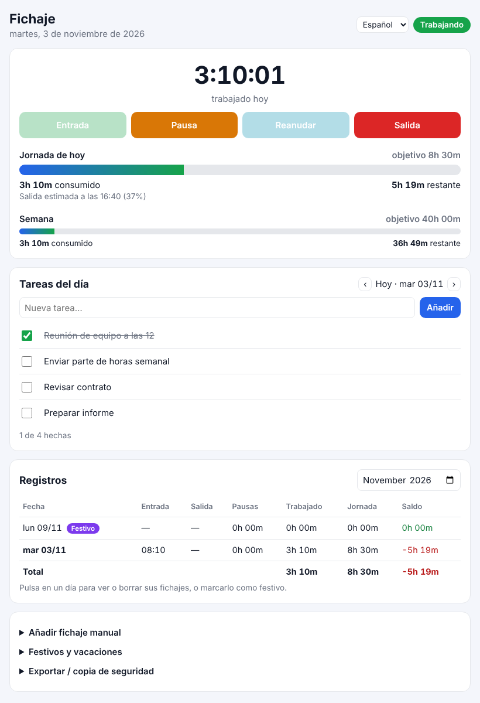
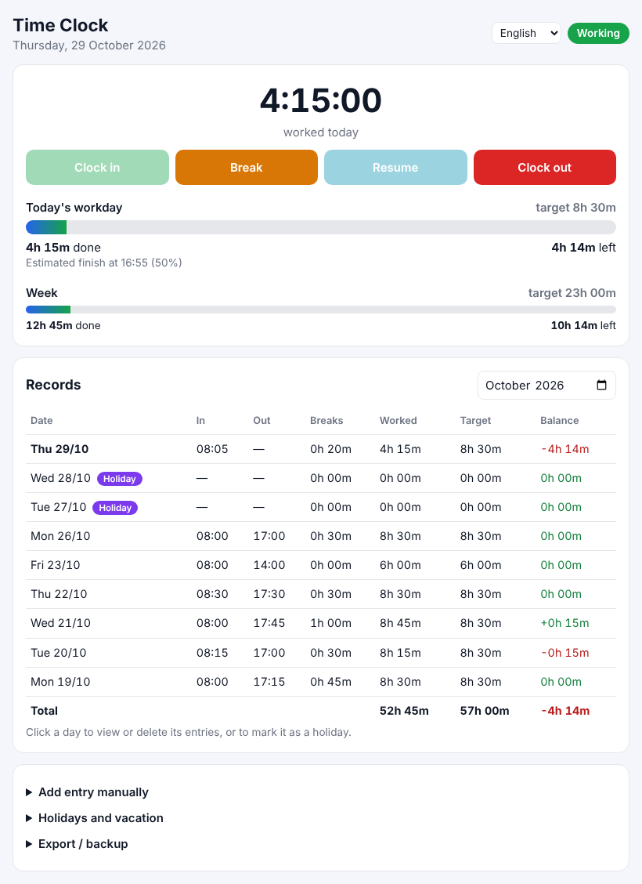
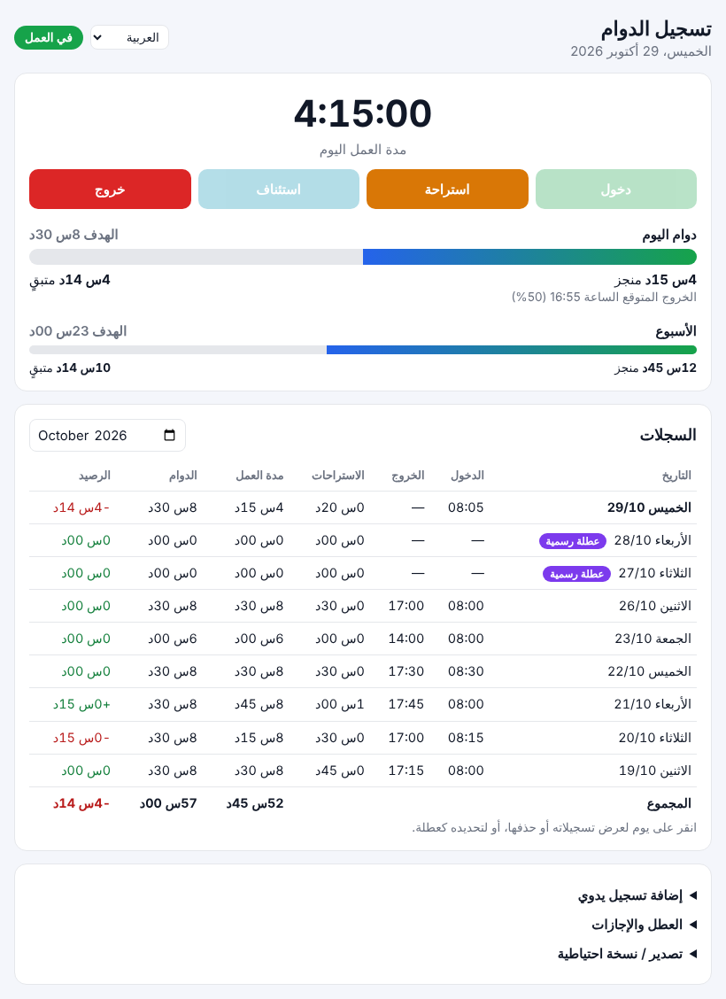
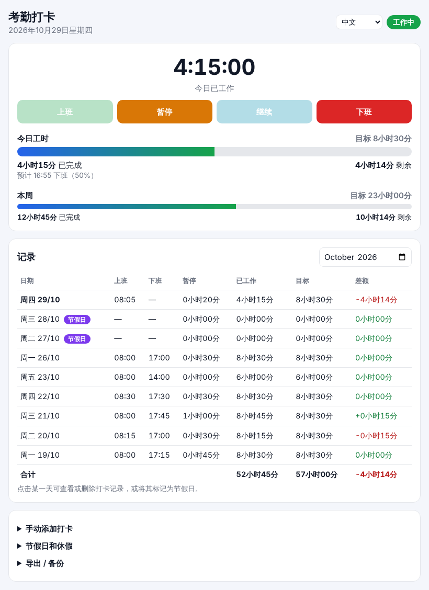
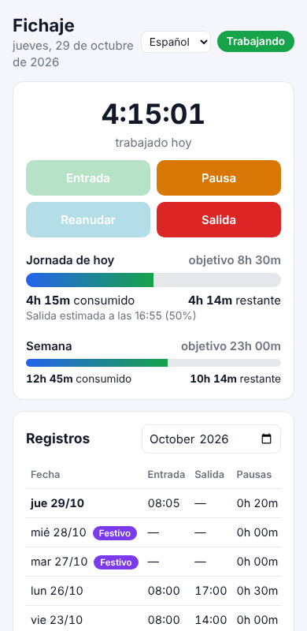

# Fichaje · Time Clock

Aplicación de control horario para fichar desde el navegador: **Entrada**, **Pausa**, **Reanudar** y **Salida**, con barra de progreso de la jornada, cómputo semanal y tabla de registros.

Funciona como **extensión de Chrome** y como **webapp instalable (PWA)**. No necesita servidor ni base de datos: los datos se guardan en el propio navegador.

🌐 **Webapp:** https://jamm87.github.io/timer/



[English](#english) · [Capturas](#capturas)

## Funcionalidades

- **Cuenta atrás.** El reloj principal muestra el tiempo que falta para completar la jornada (y las horas extra cuando te pasas). Pulsándolo cambia a tiempo trabajado.
- **Copia automática en un fichero.** Cada cambio se guarda también en un fichero JSON de tu ordenador, así los datos no se pierden aunque el navegador borre su almacenamiento.
- **Sincronización entre dispositivos.** Con un token de tu cuenta de GitHub, los datos se guardan en un Gist secreto y se ven en el ordenador y en el móvil. Los cambios de cada dispositivo se fusionan, también los hechos sin conexión.
- **Fichaje en un clic.** Solo se activan los botones válidos en cada momento: no se puede pausar sin haber entrado, ni reanudar sin estar en pausa.
- **Barra de progreso diaria** con el tiempo consumido, el restante y la hora estimada de salida. Si te pasas, el exceso aparece como horas extra.
- **Cómputo semanal** frente al objetivo de la semana.
- **Tabla mensual** con entrada, salida, pausas, tiempo trabajado, jornada y saldo de cada día, más el total del mes. Al pulsar un día ves sus fichajes y puedes borrarlos.
- **Tareas del día.** Una pequeña lista de tareas por día en la misma pantalla: añadir, marcar como hecha, editar y borrar. Con las flechas puedes ver otros días, y con un botón traes a hoy las pendientes del último día.
- **Festivos y vacaciones.** Un día marcado tiene jornada 0h y no cuenta para el objetivo semanal ni para el saldo.
- **Guardado automático.** Todo se guarda al momento, sin botón de guardar.
- **Fichajes manuales** para cuando se te olvida fichar.
- **Exportación** del mes a CSV (se abre en Excel) y **copia de seguridad** completa en JSON (fichajes, festivos y tareas).
- **5 idiomas:** español, inglés, francés, árabe (de derecha a izquierda) y chino. El idioma se detecta del navegador y se puede cambiar en la parte superior.
- **Sin conexión.** La webapp funciona offline una vez instalada.
- **Modo oscuro** automático y diseño adaptado al móvil.

## Jornada

| Día | Horas |
|---|---|
| Lunes a jueves | 8h 30m |
| Viernes | 6h |
| Sábado y domingo | No laborable |

Total semanal: **40h**. Para cambiarlo, edita `TARGET_HOURS` al principio de [`app.js`](app.js).

## Instalación

### Como webapp (PWA)

1. Abre https://jamm87.github.io/timer/ en Chrome.
2. Pulsa el icono **Instalar** de la barra de direcciones. En el móvil: menú → *Añadir a pantalla de inicio*.

La web se publica automáticamente en GitHub Pages con cada push a `main` (workflow [`pages.yml`](.github/workflows/pages.yml)). Requiere *Settings → Pages → Source: GitHub Actions*.

### Como extensión de Chrome

1. Descarga el repositorio (*Code → Download ZIP*) y descomprímelo.
2. Abre `chrome://extensions` y activa el **Modo de desarrollador**.
3. Pulsa **Cargar descomprimida** y selecciona la carpeta.
4. Fija el icono en la barra. Al pulsarlo se abre el panel para fichar; con ⤢ se abre en una pestaña.

### En local

```bash
python3 -m http.server 8000
# abre http://localhost:8000
```

## Datos y privacidad

- Todo se guarda en el `localStorage` del navegador. No se envía nada a ningún servidor.
- La extensión y la webapp tienen almacenamientos independientes. Para pasar los datos de una a otra, usa *Copia completa (JSON)* y *Restaurar JSON*.
- **Copia automática (recomendado).** En Chrome o Edge de escritorio, pulsa *Guardar en un fichero* en el aviso superior y elige dónde guardarlo (por ejemplo, una carpeta de iCloud Drive o Google Drive). Desde ese momento cada cambio se escribe también en ese fichero.
- Si el navegador borra los datos, pulsa *Abrir fichero existente*, elige el fichero y se recupera todo.
- Al volver a abrir la app, Chrome puede pedir de nuevo permiso para escribir en el fichero: pulsa *Reactivar* y elige *Permitir en cada visita*.
- En navegadores sin esta función (Safari, Firefox, móviles) los datos solo están en el navegador: exporta copias JSON a mano.

## Sincronizar entre dispositivos

Los datos se guardan en un Gist secreto de tu cuenta de GitHub. No hace falta servidor ni base de datos.

1. En GitHub, crea un token en *Settings → Developer settings → Personal access tokens → Fine-grained tokens* ([enlace directo](https://github.com/settings/personal-access-tokens/new)). En *Account permissions*, pon **Gists: Read and write**. No hace falta dar acceso a ningún repositorio.
2. En la app, abre **Sincronizar entre dispositivos**, pega el token y pulsa **Conectar**.
3. Repite el paso 2 en cada dispositivo con el mismo token. El primero crea el Gist; los demás lo encuentran solos.

La app sincroniza al abrirse, al volver a ella, un par de segundos después de cada cambio y cada minuto. Arriba se ve el estado (`☁ Sincronizado · 11:20`).

- El token se guarda en el navegador de cada dispositivo y no se sube al Gist. **Desconectar** lo borra de ese dispositivo.
- Un Gist secreto no aparece en listados, pero quien tenga su URL puede leerlo. Contiene las horas de fichaje, los festivos y las tareas.
- Si el token caduca o lo revocas, la app avisa y basta con conectar con uno nuevo.

## Estructura

```
index.html            Interfaz
styles.css            Estilos (claro/oscuro, RTL)
app.js                Lógica: fichajes, cálculos, tabla, exportación
i18n.js               Traducciones (es, en, fr, ar, zh)
merge.js              Fusión de datos entre dispositivos
sync.js               Sincronización con un Gist de GitHub
backup.js             Copia automática en un fichero del ordenador
DESIGN.md             Sistema de diseño Skylearn (referencia)
sw.js                 Service worker (uso sin conexión)
manifest.webmanifest  Manifiesto de la PWA
manifest.json         Manifiesto de la extensión de Chrome (MV3)
_locales/             Nombre y descripción de la extensión por idioma
icons/                Iconos
docs/                 Capturas
```

Para añadir un idioma, añade una entrada en `LANGS` y `STRINGS` en [`i18n.js`](i18n.js) y una carpeta en `_locales/`.

## Capturas

| English | العربية | 中文 | Móvil |
|---|---|---|---|
|  |  |  |  |

---

## English

**Time Clock** is a browser-based time-tracking app: clock in, take breaks, resume and clock out. It shows a daily progress bar (time done, time left and estimated finish time), a weekly total and a monthly table of records with the balance for each day.

- Workday: 8h 30m Monday to Thursday, 6h on Friday (configurable in `TARGET_HOURS` in `app.js`).
- Holidays and vacation days count as 0h.
- A small daily to-do list, with a button to bring over unfinished tasks from the previous day.
- Everything is saved automatically, with an optional automatic backup to a file on your computer (Chrome/Edge desktop).
- Optional sync across devices through a secret Gist in your GitHub account (paste a token with the Gists permission on each device).
- The main clock counts down the time left in the workday.
- Manual entries, CSV export and JSON backup/restore.
- Available in Spanish, English, French, Arabic and Chinese.
- Works as a Chrome extension (load the folder unpacked from `chrome://extensions`) and as an installable, offline-capable PWA: https://jamm87.github.io/timer/
- No backend: all data stays in the browser's `localStorage`.
