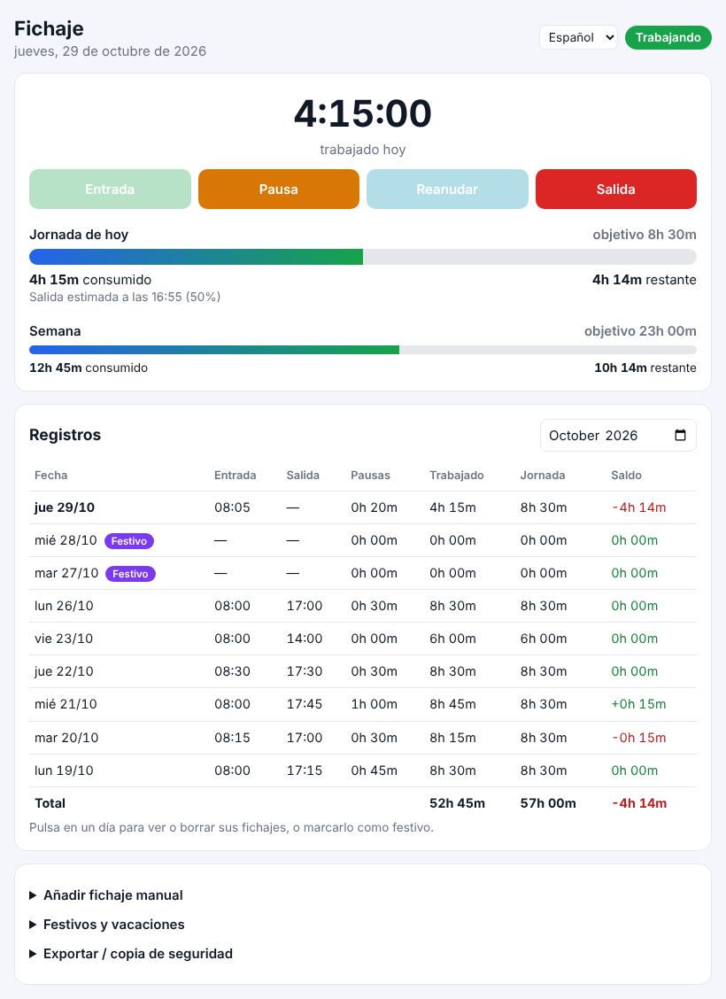
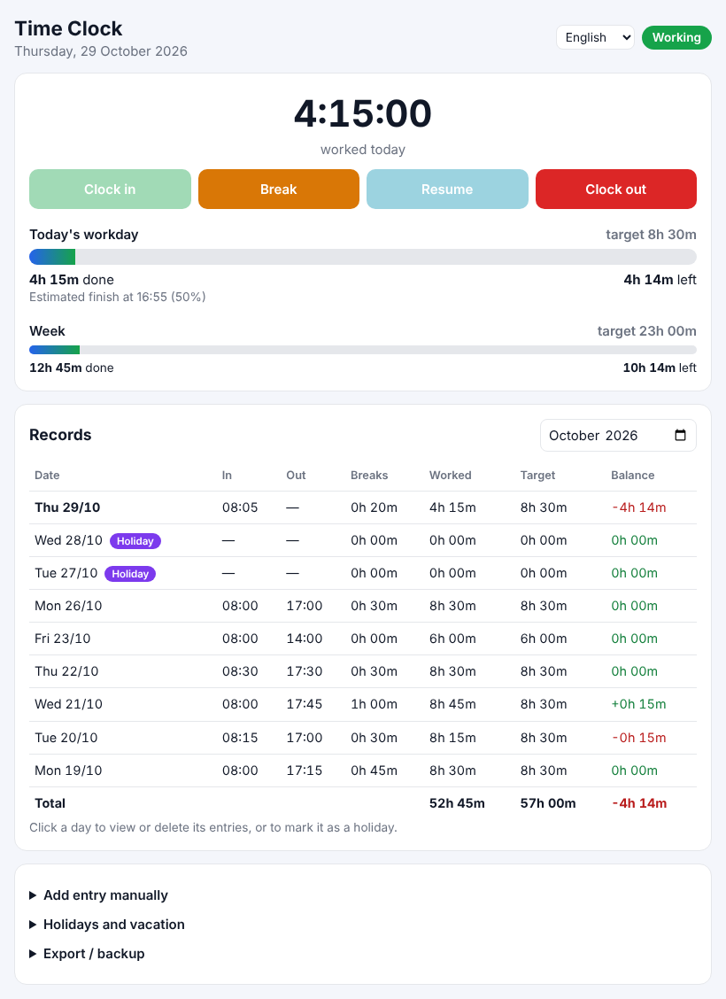
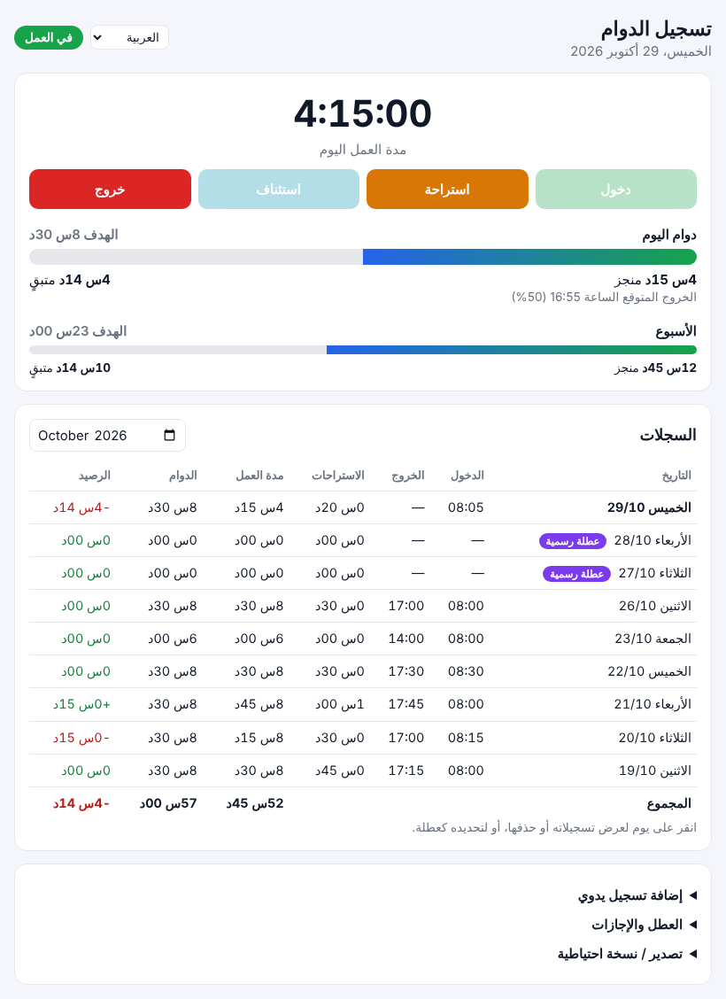
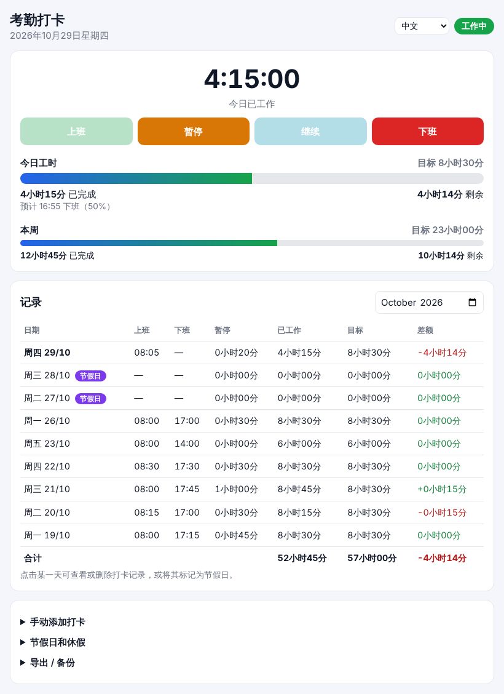
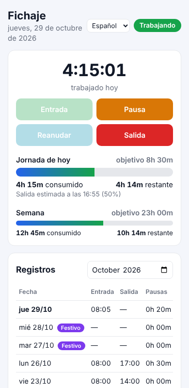

# Fichaje · Time Clock

Aplicación de control horario para fichar desde el navegador: **Entrada**, **Pausa**, **Reanudar** y **Salida**, con barra de progreso de la jornada, cómputo semanal y tabla de registros.

Funciona como **extensión de Chrome** y como **webapp instalable (PWA)**. No necesita servidor ni base de datos: los datos se guardan en el propio navegador.

🌐 **Webapp:** https://jamm87.github.io/timer/



[English](#english) · [Capturas](#capturas)

## Funcionalidades

- **Fichaje en un clic.** Solo se activan los botones válidos en cada momento: no se puede pausar sin haber entrado, ni reanudar sin estar en pausa.
- **Barra de progreso diaria** con el tiempo consumido, el restante y la hora estimada de salida. Si te pasas, el exceso aparece como horas extra.
- **Cómputo semanal** frente al objetivo de la semana.
- **Tabla mensual** con entrada, salida, pausas, tiempo trabajado, jornada y saldo de cada día, más el total del mes. Al pulsar un día ves sus fichajes y puedes borrarlos.
- **Festivos y vacaciones.** Un día marcado tiene jornada 0h y no cuenta para el objetivo semanal ni para el saldo.
- **Fichajes manuales** para cuando se te olvida fichar.
- **Exportación** del mes a CSV (se abre en Excel) y **copia de seguridad** completa en JSON.
- **5 idiomas:** español, inglés, francés, árabe (de derecha a izquierda) y chino. El idioma se detecta del navegador y se puede cambiar en la parte superior.
- **Sin conexión.** La webapp funciona offline una vez instalada.
- **Modo oscuro** automático y diseño adaptado al móvil.

## Jornada

| Día | Horas |
|---|---|
| Lunes a jueves | 8h 30m |
| Viernes | 6h |
| Sábado y domingo | No laborable |

Total semanal: **40h**. Para cambiarlo, edita `TARGET_HOURS` al principio de [`app.js`](app.js).

## Instalación

### Como webapp (PWA)

1. Abre https://jamm87.github.io/timer/ en Chrome.
2. Pulsa el icono **Instalar** de la barra de direcciones. En el móvil: menú → *Añadir a pantalla de inicio*.

La web se publica automáticamente en GitHub Pages con cada push a `main` (workflow [`pages.yml`](.github/workflows/pages.yml)). Requiere *Settings → Pages → Source: GitHub Actions*.

### Como extensión de Chrome

1. Descarga el repositorio (*Code → Download ZIP*) y descomprímelo.
2. Abre `chrome://extensions` y activa el **Modo de desarrollador**.
3. Pulsa **Cargar descomprimida** y selecciona la carpeta.
4. Fija el icono en la barra. Al pulsarlo se abre el panel para fichar; con ⤢ se abre en una pestaña.

### En local

```bash
python3 -m http.server 8000
# abre http://localhost:8000
```

## Datos y privacidad

- Todo se guarda en el `localStorage` del navegador. No se envía nada a ningún servidor.
- La extensión y la webapp tienen almacenamientos independientes. Para pasar los datos de una a otra, usa *Copia completa (JSON)* y *Restaurar JSON*.
- Si borras los datos de navegación, se pierden los registros. Haz copias de seguridad de vez en cuando.

## Estructura

```
index.html            Interfaz
styles.css            Estilos (claro/oscuro, RTL)
app.js                Lógica: fichajes, cálculos, tabla, exportación
i18n.js               Traducciones (es, en, fr, ar, zh)
sw.js                 Service worker (uso sin conexión)
manifest.webmanifest  Manifiesto de la PWA
manifest.json         Manifiesto de la extensión de Chrome (MV3)
_locales/             Nombre y descripción de la extensión por idioma
icons/                Iconos
docs/                 Capturas
```

Para añadir un idioma, añade una entrada en `LANGS` y `STRINGS` en [`i18n.js`](i18n.js) y una carpeta en `_locales/`.

## Capturas

| English | العربية | 中文 | Móvil |
|---|---|---|---|
|  |  |  |  |

---

## English

**Time Clock** is a browser-based time-tracking app: clock in, take breaks, resume and clock out. It shows a daily progress bar (time done, time left and estimated finish time), a weekly total and a monthly table of records with the balance for each day.

- Workday: 8h 30m Monday to Thursday, 6h on Friday (configurable in `TARGET_HOURS` in `app.js`).
- Holidays and vacation days count as 0h.
- Manual entries, CSV export and JSON backup/restore.
- Available in Spanish, English, French, Arabic and Chinese.
- Works as a Chrome extension (load the folder unpacked from `chrome://extensions`) and as an installable, offline-capable PWA: https://jamm87.github.io/timer/
- No backend: all data stays in the browser's `localStorage`.
